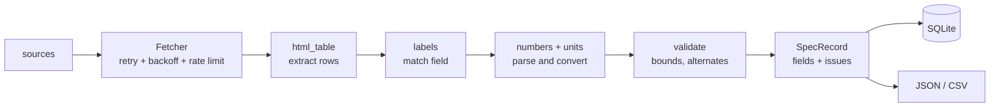

# machine-spec-parser

Turn messy **industrial-machine datasheets** (HTML) into clean, unit-normalized, validated specs, stored in SQLite and exportable as JSON/CSV. Pure standard library at runtime.

Real datasheets are inconsistent: `1,500` can mean fifteen hundred or one and a half, power comes as `22 kW (29.5 hp)`, a Persian page writes `۱۰٫۵ بار` and dates the machine `۱۴۰۱`, and somebody types `690 dB(A)`. This project shows how to handle that **explicitly and safely**: normalize what is certain, flag what is doubtful, and refuse to guess what is unknowable.

> **Disclaimer:** the manufacturers (Vortex, Helix, Ironwood, Nimbus, Quanta), machines and numbers in `data/datasheets/` are entirely fictional. The project never contacts any website; it reads local files through a pluggable `Fetcher`.

## What it does

| Raw text on the page | Normalized result |
|---|---|
| `22 kW (29.5 hp)` | `rated_power = 22 kW`, alternate cross-checked against the primary |
| `75 kW (90 hp)` | `75 kW` + **warning**: the alternate says 67.1 kW |
| `12.4 m³/min` | `flow_rate = 744 m³/h` |
| `125 psi`, `2,755 lbs`, `94 x 44 x 70 in` | `8.62 bar`, `1249.65 kg`, `2387.6 × 1117.6 × 1778 mm` |
| `14 – 104 °F` | `-10 – 40 °C` |
| `400 V ±10%` | `400 ± 40 V` |
| `3.500 kg` on a German page / `3,500 kg` on an English page | `3500 kg` (the page language settles the separator) |
| `1,500` on a page with no language | `1500` + **warning**: ambiguous separator |
| `۱۰٫۵ بار`, `۱۵ کیلووات` | `10.5 bar`, `15 kW` |
| `سال ساخت: ۱۴۰۱` | `2022` (Solar Hijri converted, noted as info) |
| `Voltage: 460` | **dropped** + warning: no unit, refusing to guess |
| `Capacity: 440 cfm` / `Capacity: 3,500 kg` | `flow_rate` / `load_capacity`, chosen by the unit |
| `Motor outpt` (typo) | matched to `rated_power` + info (fuzzy label) |
| `Noise level: 690 dB(A)` | kept, marked **suspect**, warning (plausible range 20-160) |

Other pieces: model-name canonicalization (`VORTEX CNC 300` / `Vortex cnc300` / `Vortex CNC-300` -> one key), three table layouts (2 columns, 3 columns with a unit column, `<dl>`), fetching with **retry + exponential backoff + jitter** and a **rate limiter**, an issue taxonomy with severities, and a small CLI to parse, list, show and compare machines.

## Quick start (WSL Ubuntu + VS Code + uv)

```bash
# 1) install uv once (skip if you already have it)
curl -LsSf https://astral.sh/uv/install.sh | sh

# 2) enter the project and open it in VS Code from WSL
cd machine-spec-parser
code .

# 3) create the virtualenv and install the dev tools
uv sync

# 4) parse the bundled sample datasheets
uv run specparse parse data/datasheets --db specs.db --json out.json --csv out.csv

# 5) explore the results
uv run specparse list --db specs.db
uv run specparse show "ironwood fl35e" --db specs.db
uv run specparse compare "helix rs 75" "nimbus cp150" "vortex cnc300" --db specs.db
uv run specparse issues --db specs.db --min-severity warning

# 6) tests, lint, format
uv run pytest
uv run ruff check .
uv run ruff format .
```

`uv run python -m machine_spec_parser ...` works too. The runtime has **no third-party dependencies**; `pytest` and `ruff` are dev-only. Commit the `uv.lock` that `uv sync` generates. VS Code picks up `.venv/bin/python` automatically (`.vscode/settings.json`) and discovers the tests.

## Example run

```text
$ uv run specparse parse data/datasheets --db specs.db
Parsing 5 source(s)

OK    HELIX RS-75          14 fields  0 warning(s)  helix-rs-75.html
OK    IRONWOOD FL-35-E     13 fields  0 warning(s)  ironwood-fl-35e.html
OK    NIMBUS CP-150        11 fields  0 warning(s)  nimbus-cp-150-fa.html
WARN  QUANTA X-9           11 fields  6 warning(s)  quanta-x9.html
        warning conflicting_values: alternate 90 hp = 67.11 kW differs from the primary value 75 by 10.5%; kept the primary
        warning ambiguous_number: thousands/decimal separator is ambiguous; assumed 1249.65
        warning unit_missing: value has no unit; refusing to guess one
        warning out_of_range: 690 dB(A) is outside the plausible range 20–160 dB(A)
        warning ambiguous_number: thousands/decimal separator is ambiguous; assumed 3550
        warning unparseable_value: no four-digit year found
OK    VORTEX CNC-300       14 fields  0 warning(s)  vortex-cnc-300.html

5 model(s) accepted, 0 rejected, 0 fetch failure(s); issues: 0 error, 6 warning, 8 info
saved to specs.db
```

The five pages exercise different situations: `vortex-cnc-300` (English table with a script tag and `±10%`), `helix-rs-75` (three-column layout, unit hints in labels), `ironwood-fl-35e` (German `<dl>` with decimal commas), `nimbus-cp-150-fa` (Persian, RTL, Persian digits and units, Solar Hijri year), and `quanta-x9` (deliberately messy).

Compare machines side by side (note the unit conversions, the `—` for fields a page did not provide, and the `(suspect)` flag):

```text
$ uv run specparse compare "helix rs 75" "nimbus cp150" "vortex cnc300" "quanta x9" --db specs.db
field                  HELIX RS-75   NIMBUS CP-150  VORTEX CNC-300        QUANTA X-9
---------------------  ------------  -------------  --------------------  --------------------
rated_power            75 kW         15 kW          22 kW                 75 kW
working_pressure       8.5 bar       10.5 bar       —                     8.61845 bar
flow_rate              744 m³/h      150 m³/h       —                     747.565 m³/h
rotational_speed       2980 rpm      2900 rpm       4500 rpm              3550 rpm
supply_voltage         400 V         380 V          400 ± 40 V            —
frequency              50 Hz         50 Hz          50 Hz                 60 Hz
weight                 1250 kg       240 kg         6800 kg               1249.65 kg
noise_level            69 ± 3 dB(A)  72 dB(A)       74 dB(A)              690 dB(A)  (suspect)
operating_temperature  —             —              5–40 °C               -10–40 °C
operating_hours        7500 h        3200 h         11000 h               —
year_of_manufacture    2021          2022           2019                  —
ingress_protection     IP55          IP55           IP54                  —
length_mm              2400 mm       —              3200 mm               2387.6 mm
width_mm               1100 mm       —              1750 mm               1117.6 mm
height_mm              1750 mm       —              2100 mm               1778 mm
drive_type             —             —              Servo / direct drive  —
```

See the original text next to the normalized value:

```text
$ uv run specparse show "ironwood fl35e" --db specs.db
IRONWOOD FL-35-E
field                value               raw text on the page
-------------------  ------------------  ------------------------
rated_power          11.5 kW             11,5 kW
load_capacity        3500 kg             3.500 kg
supply_voltage       80 V                80 V
weight               5250 kg             5.250 kg
noise_level          68 dB(A)            68 dB(A)
operating_hours      8420 h              8.420 h
lift_height          4500 mm             4.500 mm
year_of_manufacture  2020                2020
ingress_protection   IP54                IP54
length_mm            2650 mm             2.650 × 1.150 × 2.100 mm
width_mm             1150 mm             2.650 × 1.150 × 2.100 mm
height_mm            2100 mm             2.650 × 1.150 × 2.100 mm
drive_type           Elektro, Drehstrom  Elektro, Drehstrom
```

Resilient fetching can be demoed without any network. `--flaky` injects transient failures; permanent ones (a missing file) are reported after the retries are exhausted:

```text
$ uv run specparse parse data/datasheets/helix-rs-75.html data/datasheets/missing.html --flaky 0.5 --seed 3 --quiet
Parsing 2 source(s)

  retry   helix-rs-75.html: attempt 1 failed, waiting 0.45s
  retry   missing.html: attempt 1 failed, waiting 0.51s
OK    HELIX RS-75          14 fields  0 warning(s)  helix-rs-75.html
FAIL  data/datasheets/missing.html: no such file: data/datasheets/missing.html (after 2 attempt(s))

1 model(s) accepted, 0 rejected, 1 fetch failure(s); issues: 1 error, 0 warning, 1 info
```

JSON output keeps both the value and what the page originally said:

```json
"rated_power": { "value": 22.0, "unit": "kW", "suspect": false, "raw": "22 kW (29.5 hp)" },
"supply_voltage": { "value": 400.0, "tolerance": 40.0, "unit": "V", "raw": "400 V ±10%" },
"operating_temperature": { "minimum": 5.0, "maximum": 40.0, "unit": "°C", "raw": "5 – 40 °C" }
```

## How decisions are made

1. **Extract** (`html_table.py`): title, `h1`, `lang`, `<meta name="category">` and `(label, value[, unit])` rows. Scripts and styles are ignored; `<th>`-only header rows are skipped.
2. **Identify** (`names.py`): the heading becomes `(manufacturer, model, key)`, e.g. `VORTEX CNC-300`. Latin text inside a Persian heading is used; descriptive words such as "Turning Center" are dropped.
3. **Match the label** (`labels.py`): case, spaces and punctuation are ignored; English, German and Persian synonyms are supported; a trailing `[bar]` / `(kg)` / `, kg` is read as a **unit hint**; typos fall back to fuzzy matching (reported as info). A label may have several candidates (`Capacity`).
4. **Read the number** (`numbers.py`): handles `1,234.5`, `1.234,5`, `11 000`, ranges (`5 - 10`, `5 to 10`, `5~10`), tolerances (`±`, `%`), negatives, and parenthesised alternates. The page language provides a decimal-separator hint (`de` -> comma, `en`/`fa` -> dot).
5. **Convert** (`units.py`): spelling-insensitive unit lookup (`m³/min`, `m3/min`, `M3/MIN`), Persian unit names, temperature offsets, and tolerance *differences* that ignore the offset. Canonical units: kW, bar, m³/h, kg, mm, rpm, V, Hz, °C, dB(A), A, h.
6. **Validate** (`normalize.py`): plausible ranges, alternate cross-checks (3% tolerance), duplicate fields on one page, and the issue taxonomy below.

### Issue codes

| Severity | Codes | Meaning |
|---|---|---|
| `error` | `unit_mismatch`, `missing_model`, `fetch_failed` | the value or page could not be used |
| `warning` | `unit_missing`, `unparseable_value`, `ambiguous_number`, `out_of_range`, `conflicting_values` | value dropped or kept-but-doubtful; a human should look |
| `info` | `unknown_label`, `fuzzy_label`, `missing_value`, `calendar_converted`, `duplicate_model` | worth knowing, nothing to fix |

`specparse parse --strict` exits with code 1 if any `error` exists, which makes it usable in CI.

## Architecture



`pipeline.parse_html()` is a pure function (HTML in, record out), so almost everything is tested without files, network or clock. `pipeline.run()` adds fetching, retries, de-duplication by model key and the report.

## Project layout

```text
machine-spec-parser/
├── pyproject.toml
├── data/datasheets/          # five fictional sample pages (en, de, fa, messy)
├── src/machine_spec_parser/
│   ├── textnorm.py           # Persian/Arabic digits, Unicode folding
│   ├── numbers.py            # separators, ranges, tolerances, alternates
│   ├── units.py              # unit registry and conversion
│   ├── labels.py             # label synonyms (en/de/fa), unit hints, fuzzy match
│   ├── names.py              # heading -> manufacturer / model / key
│   ├── html_table.py         # stdlib HTMLParser extraction
│   ├── normalize.py          # row-level rules and validation
│   ├── models.py             # SpecRecord, SpecField, Issue, ...
│   ├── fetch.py              # Fetcher protocol, retry/backoff, rate limiter
│   ├── pipeline.py           # parse_html() and run()
│   ├── store.py              # SQLite schema and queries
│   └── cli.py                # specparse
└── tests/                    # ~225 test cases, one file per module
```

## Design notes and limitations

* **Refusing to guess is a feature.** A silent default unit corrupts data without anyone noticing; a warning costs one line in a report.
* **Model keys are consistent, not pretty.** The rule "hyphen between letters and digits" turns `FL-35E` into `FL-35-E`. The same machine always lands on the same key, which is what de-duplication needs.
* **Dimensions are assumed to be L x W x H.** There is no reliable way to verify the order from the text.
* **Solar Hijri conversion is approximate** (`year + 621`); the true Gregorian year depends on the month. It is applied only on pages declared `lang="fa"` and is always reported.
* **One brand-less heading word is enough to confuse the model detector**, which is why the registry in `names.py` is a short list of fictional makers plus a heuristic for unknown brands. A production system would use a maintained catalogue.
* Real-world scraping needs permission: respect each site's terms and `robots.txt`. Only a file-based fetcher ships here on purpose.

## Ideas for extension

* An `HttpFetcher` (e.g. `urllib` or `httpx`) that maps 5xx/timeouts to `FetchError(transient=True)` and 4xx to `transient=False`; the retry and rate-limit code is already generic.
* More label synonyms and units; a YAML/TOML file for them instead of Python tables.
* PDF datasheets (extract text first, then reuse the same normalizer).
* A FastAPI endpoint that accepts HTML and returns the normalized record plus issues.

## License

MIT, see `LICENSE`.
